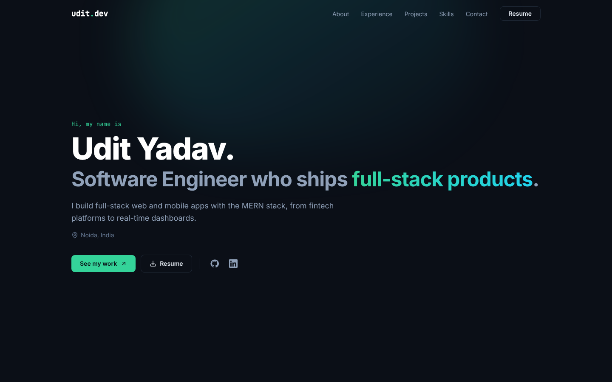
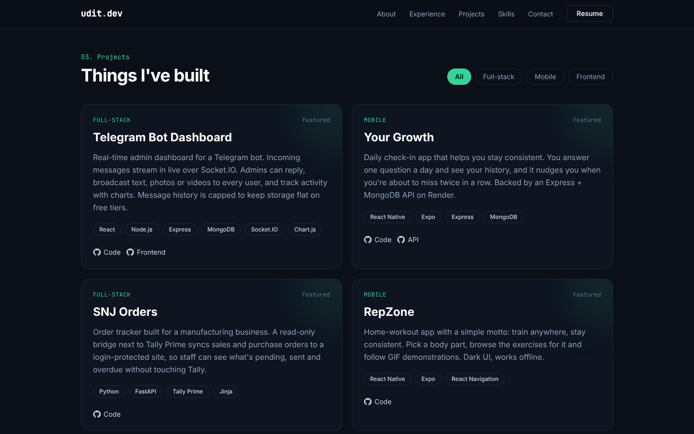
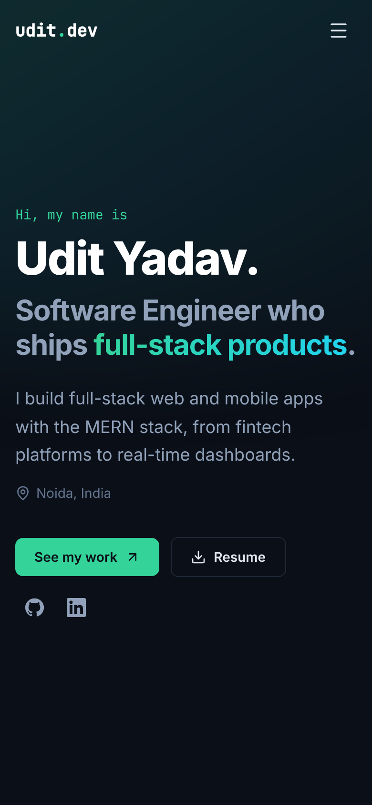

<h1 align="center">Udit Yadav · Portfolio</h1>

<p align="center">
  My personal developer portfolio, built with the <b>MERN</b> stack.<br/>
  <a href="https://uy-portfolio.netlify.app"><b>🌐 Live site</b></a>
</p>

<p align="center">
  
  
  
  
  
  
</p>



## ✨ Features
- **Single-page layout** with Hero, About, Experience, Projects, Skills and Contact sections
- **Filterable projects** (All, Full-stack, Mobile, Frontend), loaded from MongoDB through the API
- **Contact form** that saves messages to MongoDB, with validation, rate limiting and a spam honeypot
- **Works without the API**: project data is bundled too, so the site never shows empty sections
- **One content file** (`shared/portfolio.json`) for the profile, experience, projects and skills
- Responsive dark design, scroll-reveal animations that respect reduced motion, accessible navigation

| Projects | Mobile |
|---|---|
|  |  |

## 🛠️ Tech stack
| Layer | Tools |
|---|---|
| Frontend (`client/`) | React 18, Vite, Tailwind CSS v4, lucide-react |
| Backend (`server/`) | Node.js, Express 5, Mongoose, Helmet, CORS, express-rate-limit |
| Database | MongoDB Atlas |
| Hosting | Netlify (frontend), Render (API) |

## 🚀 Run locally
**Prerequisites:** Node.js 18+ and, optionally, a MongoDB connection string.

```bash
git clone https://github.com/udit065/my-portfolio.git
cd my-portfolio
npm run install:all

cp server/.env.example server/.env   # add MONGO_URI (optional)
npm run dev:server                   # API on http://localhost:5000
npm run dev:client                   # site on http://localhost:5173 (proxies /api)
```
Without `MONGO_URI`, the API serves projects from `shared/portfolio.json` and the contact form asks visitors to email instead.

### Environment variables
| File | Variable | Purpose |
|---|---|---|
| `server/.env` | `MONGO_URI` | MongoDB connection string |
| `server/.env` | `CLIENT_URL` | Allowed frontend origin(s), comma-separated |
| `server/.env` | `PORT` | API port (default `5000`) |
| `client/.env` | `VITE_API_URL` | Deployed API URL (leave empty locally) |

## 🔌 API
| Method | Route | Purpose |
|---|---|---|
| GET | `/api/health` | Health check and DB status |
| GET | `/api/portfolio` | All site content |
| GET | `/api/projects` | Projects (MongoDB, with the JSON as a fallback) |
| POST | `/api/contact` | Save a contact message |

Run `npm run seed` to load the projects into MongoDB.

## ☁️ Deploy
- **Frontend:** Netlify reads `netlify.toml`, builds `client/` and publishes `client/dist`. Set `VITE_API_URL` to the API URL.
- **API:** Render → New → Blueprint → this repo (`render.yaml`). Set `MONGO_URI`, and set `CLIENT_URL` to the Netlify URL.

## 📁 Project structure
```
my-portfolio/
├── client/          React + Vite frontend
├── server/          Express + MongoDB API
├── shared/          portfolio.json (all site content)
├── docs/            README screenshots
├── netlify.toml     frontend deploy config
└── render.yaml      API deploy config
```

## 📄 License
[MIT](LICENSE) © Udit Yadav

---
**Udit Yadav** · [GitHub](https://github.com/udit065) · [LinkedIn](https://www.linkedin.com/in/udit-yadav065) · udityadav133@gmail.com
